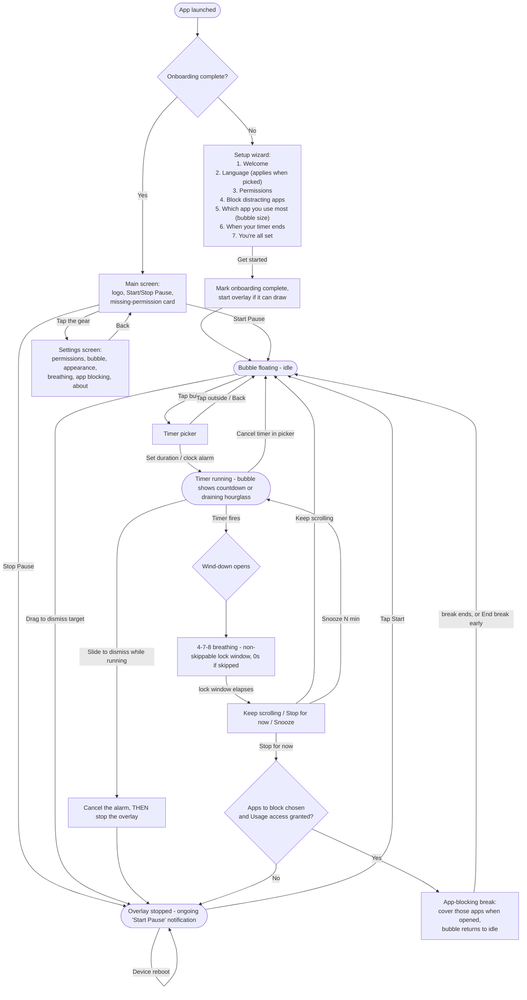
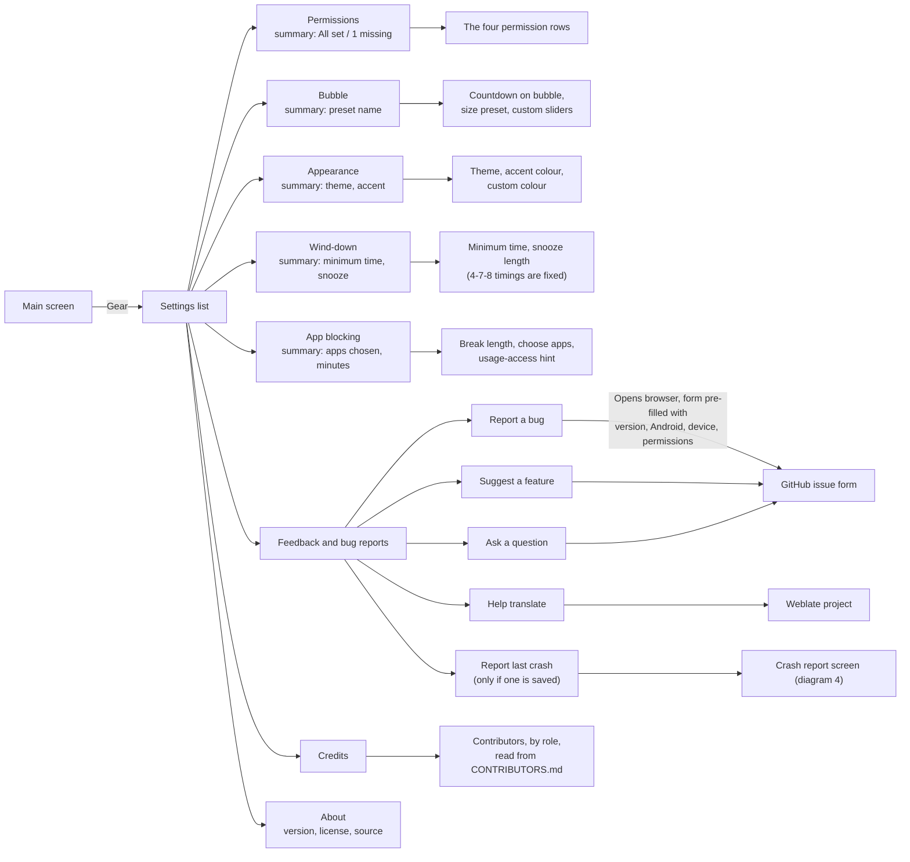
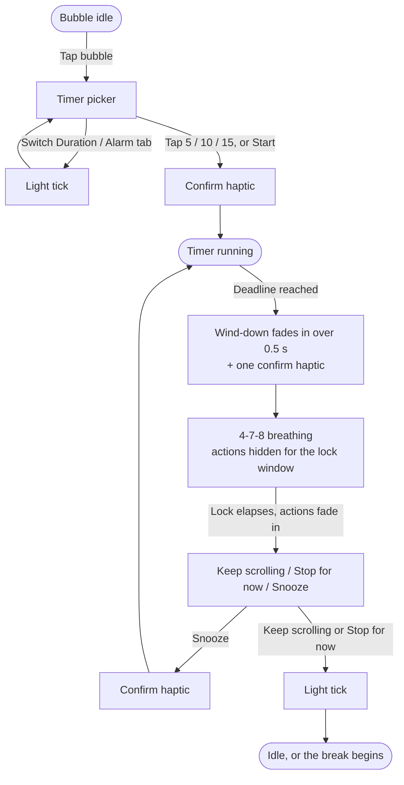
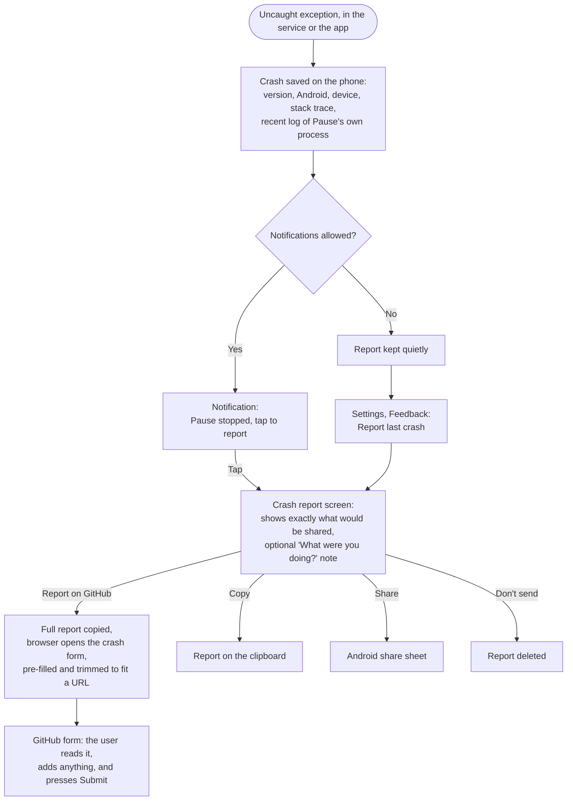

# Pause — behaviour flow

How the app moves between its states: first-run setup, the floating bubble, the timer,
the wind-down, and the app-blocking break. (Renders as a diagram on GitHub.)

The first diagram is what the app does. The three after it are plans for the designers to check
before anything is built; each says which branch it belongs to, and moves up into the first
diagram when its change lands.

| # | Diagram | Status |
|---|---|---|
| 1 | The whole app | Current (with `feat/simple-main-screen`) |
| 2 | Settings map | Proposed: settings hub |
| 3 | Timer feedback moments | In progress: haptics and fade-in |
| 4 | Crash and feedback reporting | Proposed: crash reports |

## 1. The whole app

## 2. Settings map (proposed)

The gear opens a short list of categories instead of one long scroll, in the style of One UI's own
Settings. Each row shows a one-line summary of its current state. Nothing here adds a setting; it
re-homes what exists, plus the feedback and credits pages.

Back, from any page, returns one level up: sub-page to the list, the list to the main screen.

## 3. Timer feedback moments (in progress)

Where the app now answers the user physically. A confirm haptic marks the moments that matter
(a timer set, a wind-down arriving); navigation taps keep the lighter tick so the two feel
different. The fade follows One UI's motion guide: 500 ms at most, on its own curve.

If the phone has animations or touch feedback turned off, Android's own settings suppress the fade
and the haptics; the flow is otherwise the same.

## 4. Crash and feedback reporting (proposed)

Pause has no internet permission, so nothing is sent by the app itself. A crash is saved on the
phone; the user chooses whether it goes anywhere, and "going" means opening a pre-filled GitHub issue
form in the browser.

The GitHub form requires the device, Android version, app version and permission state, so a report
can't arrive without them; the app fills them in, and a person filing by hand has to.

## Notes on specific behaviours

- **Slide to dismiss while a timer is running** drags the bubble onto the dismiss target. This
  calls `stopSelf()`, and `onDestroy()` runs `cancelPendingAlarm()` first — so the pending alarm
  is cancelled *before* the overlay is torn down, and it can never fire after the bubble is gone.
- **Keep scrolling** dismisses the wind-down only; the bubble stays floating (idle), ready for the
  next timer.
- **Stop for now** starts the app-blocking break **if** you've chosen apps to block and granted
  Usage access (the bubble returns to idle while the break covers those apps). If no apps are
  chosen, it leaves the current app and stops the overlay entirely.
- **Snooze** dismisses the wind-down and re-arms the timer for the chosen number of minutes.
- **Persistent notifications (not truly pinned).** Both are ongoing and carry `FLAG_NO_CLEAR`: the
  running foreground-service notification, and the "Start Pause" notification shown while the
  overlay is off (re-posted after a reboot by `BootReceiver`). Neither flag makes them
  undismissable. On Android 14+ the user may swipe an ongoing notification away while the app is
  backgrounded, and **Samsung's One UI removes them on "Clear" regardless of `FLAG_NO_CLEAR`** —
  confirmed on a device. Treat AOSP behaviour as the best case, not the guarantee. Real pinning
  needs Android 16's promoted-ongoing notifications, which require SDK 36; see the Google Play
  plan in ONBOARDING.md.
- **First-run wizard** shows only on first launch (gated by `SettingsStore.onboardingComplete`).
  The language is applied the moment it's picked, so every later page is already in it; below
  Android 13 that recreates the activity, which is why the wizard's state is saved across it.
